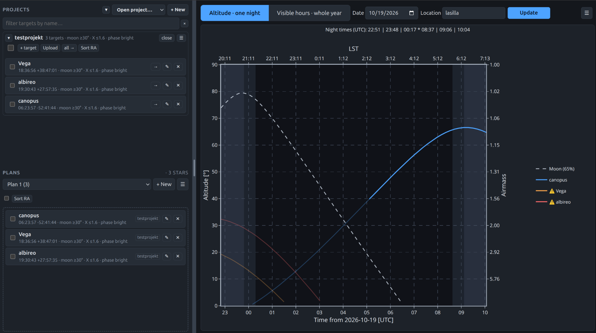
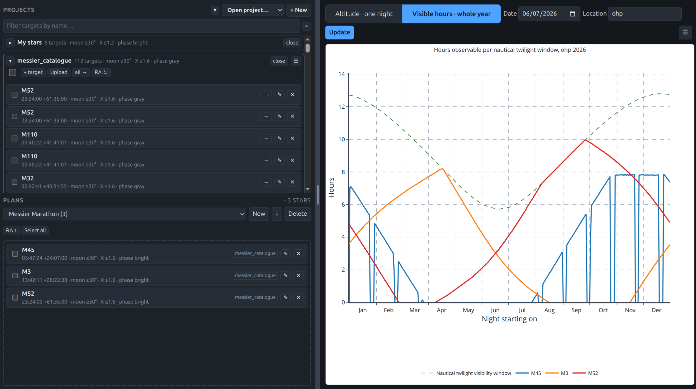

# Sky Observation Planner v0.6

**Plan your observing night, explore target visibility, and turn a list of astronomical objects into a practical observing schedule.**

Sky Observation Planner is designed to make astronomical observation planning quick and intuitive. Explore when your targets are visible from your preferred observatory with an interactive **nightly altitude plot**, or look ahead through the seasons with an **annual visibility plot**. Set your observing limits, compare the Moon's position and other observing conditions, and find suitable windows for your targets before heading to the telescope.

Start with your own CSV target catalogue, use the included Messier catalogue as an example, or look up objects directly in **SIMBAD** to build a personal target list. You can then select targets, arrange them into an observing plan, and create a timed schedule for the night. The application runs locally on your computer and opens in your web browser; its interactive plots support zooming, hovering and exporting images.



*Example of the nightly altitude plot, showing target visibility, the Moon and twilight intervals.*

## Getting started

Sky Planner uses Python, Flask and Astropy. A Conda environment is convenient, but not mandatory. Commands below should be run from the directory containing `app.py` and `requirements.txt`.

### Install the Python dependencies

If you use Conda, activate the environment where you want Sky Planner installed (the supplied GNOME launcher uses `base` by default):

```bash
conda activate base
pip install -r requirements.txt
```

### Start Sky Planner manually

```bash
python app.py
```

Open **http://127.0.0.1:5511** in your browser. The default port is `5511`; to choose another one, set `SKY_PLANNER_PORT` before starting the program.

### Install the GNOME desktop launcher (Ubuntu 24.04 and similar Linux systems)

First, extract the ZIP archive into the folder where you want to keep the application. Open a terminal **in that folder**, then run:

```bash
chmod +x launch_sky_planner.sh install_desktop_launcher.sh
./install_desktop_launcher.sh
```

Find **Sky Observation Planner** in the GNOME application menu or on the desktop (if desktop icons are enabled). The launcher activates Conda `base`, starts the local web server and opens your system's default browser. GNOME may ask you to select **Allow Launching** for the desktop icon. If you move the application folder later, run the installer again so its paths are updated.

Closing the browser tab may not immediately stop the server on every browser; shutdown detection is best effort. No separate Stop shortcut is installed.

## Author and licence

**Author:** D. Sebastian  
**Licence:** MIT License — Copyright © 2026 D. Sebastian. See [LICENSE](LICENSE) for the full terms.

## 2. Basic usage: projects and plans

### Projects: reusable target catalogues

A **project** is a collection of astronomical targets with default observing constraints. Select an existing project or use **+ New** to create one. Several projects can be open simultaneously. Add targets by hand (**+ target**) or use **Upload** to import a CSV catalogue. A SIMBAD search can fill coordinates from a target name when internet access is available. SIMBAD identifier resolution is independent of optional Gaia G photometry and radial velocity: missing values do not prevent successful coordinate lookup, and available radial velocity is filled silently.

Each target has a name, right ascension (RA) and declination (Dec). RA is expressed in hours and Dec in degrees; sexagesimal entries such as `12:30:00` and `+15:20:00` are accepted. The original coordinates are retained even when their display is reformatted.

Use the project **☰** menu for defaults, CSV export and deletion. You can reorder targets by dragging, or sort numerically by RA. Each project's RA sorting is separate from the plan's sorting. Search/filter the catalogue and use selection checkboxes or multiselection to work with several targets.

### Plans: select what to observe

A **plan** contains independent copies of project targets. Copy targets into a plan with the arrow control, multiselection or drag and drop. A target can appear more than once. Editing or removing a plan copy does **not** change the original project target.

Use **+ New** for a new plan, and the plan **☰** menu to change settings, copy the plan to a new name, export its CSV, or delete it. Targets can be reordered by dragging; their order matters in **Schedule** mode. **Sort RA** sorts all plan targets by right ascension, or only selected targets if any are selected; unselected targets keep their positions. The sorted order is saved and can be freely rearranged by dragging. **Undo** restores up to 30 previous target-list changes within the current server session (including sorting, reordering, additions and deletions). Project sorting is independent and unchanged.

### Target fields and observing limits

The target editor includes maximum **airmass**, maximum **Moon illumination** (`bright` ≤100%, `gray` ≤70%, `dark` ≤40%), minimum **Moon distance** in degrees, optional **Moon velocity separation limit** and **telluric velocity separation limit** in km/s, and optional target **radial velocity** in km/s. Velocity limits are only enforced when target RV is supplied. Leaving a velocity limit empty disables it.

The editor also stores **exposure time** (seconds), **number of exposures** (a positive integer), **delay** (minutes in the interface; seconds in stored data), and **comments** (up to 1,000 words). Exposure time and delay accept decimal numbers, including `2700.0`; number of exposures must represent a whole number.

Project defaults include airmass, Moon phase, Moon distance and optional Moon/telluric velocity limits. These are used for new project targets and can be applied to existing project targets when requested.

## 3. Sites

Sites, alraedy loaded in astropy can be selscted. See list of sites here: https://docs.astropy.org/en/stable/api/astropy.coordinates.EarthLocation.html#astropy.coordinates.EarthLocation.get_site_names

Simply start typing your preferred site and use the autofill to complete them. Sites can be added manually by adding them in the list, loaded in sites.py

## 4. Plotting

Choose the date and observing **Location**, then select either plot mode. Click **Update** to calculate; the button displays an animated **Calculating** state while processing. Plotly allows zooming, panning, legend interaction and image export. The plot color theme is independent of the surrounding website, which follows the operating system's light/dark appearance. Drag the divider to resize the catalogues and plot.

### Altitude · one night

This plot shows each target's altitude throughout the night, the Moon's altitude, twilight shading, UTC time, local sidereal time and an airmass axis. The title lists the calculated solar events; hover over it for explanations. Target hover information reports altitude, airmass, Moon separation and relevant velocity values. Low-visibility intervals are subdued or crossed; warning symbols mark targets/blocks that fail constraints. A target that stays below the horizon is **not** observable.

### Visible hours · whole year



For every night in the selected year, this plot estimates how many hours each target meets the configured observing limits. Use **☰ Settings** to select the Sun-altitude boundary for the yearly observing window: **sunset (0°)**, **civil twilight (−6°)**, **nautical twilight (−12°, default)** or **astronomical twilight (−18°)**. The same limits (airmass, Moon phase/distance and configured velocity constraints) contribute to the visibility calculation. Violations are indicated on the yearly curves. Identical targets with matching coordinates and constraints are evaluated once and identified by a count.

The visibility calculation uses time sampling (approximately two minutes); velocity ephemerides are cached/interpolated to make repeated yearly plots faster. Treat the result as an observing-planning estimate, especially close to a limit threshold.

## 5. Scheduling observations

Open the plan **☰** menu and change its **Mode** from **Plan** to **Schedule**. Schedule-only defaults then become visible:

- **Default exposure time**, with an option to apply it to every existing target in that plan.
- **Default delay between exposures**, with an option to apply the delay to every existing target in that plan.
- **Start of observation**: **sunset**, **civil**, **nautical** (default) or **astronomical twilight**.

The schedule uses the plan's **target order**. Each target is an observing block with duration

`(exposure time + delay) × number of exposures`.

The first block normally starts at the selected twilight event, based on the chosen date and observatory. Subsequent blocks follow in order. Move the time slider to shift the start. With the slider focused, press **Space**, or select **Time…**, to choose the current time, enter a UTC time or reset to the configured twilight.

A translucent time band identifies each scheduled block; target altitude curves are drawn above the bands. Scheduled segments stand out and the remaining portions are faded. Vertical lines mark block start/end. Hover **anywhere inside a block** to see that block's target data at the mouse's UTC time (including altitude, airmass, Moon distance and applicable velocities), exposure settings and overall block validity. Other targets' curves do not take over the schedule tooltip.

A block is evaluated over its complete duration: a limit violated within the block marks it with a warning symbol (including in the legend). Changing the target order, adding targets or moving the start time causes the schedule to be evaluated again. The **yearly** plot continues to show unscheduled observable hours.


## CSV catalogue import reference

**Required header fields:** `name,ra,dec`. The following are all supported canonical fields. Header aliases shown in the third column are accepted case-insensitively. Unspecified optional observing settings use the applicable project defaults.

| CSV field | Description | Accepted aliases |
|---|---|---|
| `name` | Target identifier, required | `object`, `star`, `target`, `targets` |
| `ra` | Right ascension, hours (sexagesimal or decimal), required | `alpha`, `right_ascension`, `rightascension` |
| `dec` | Declination, degrees, required | `declination`, `delta` |
| `gmag` | Gaia G magnitude (optional) | `gaia_g`, `gaia_g_magnitude`, `gaia_gmag` |
| `moon` | Minimum Moon separation, degrees | `moon_limit`, `moonlim` |
| `airmass` | Maximum airmass | `airlim`, `airmass_limit` |
| `phase` | Moon illumination category: dark / gray / bright | `moon_phase`, `moonphase` |
| `radial_velocity` | Target systemic radial velocity, km/s | `rv` |
| `moon_velocity_limit` | Minimum target–moonlight velocity separation, km/s | `moon_rv_limit` |
| `telluric_velocity_limit` | Minimum target–telluric velocity separation, km/s | `telluric_rv_limit` |
| `exposure_time` | Single-exposure duration, seconds | `exptime` |
| `exposures` | Number of exposures, positive integer | `nexp`, `number_of_exposures` |
| `delay` | Delay per exposure, seconds | `delay_seconds` |
| `comments` | Free-text notes | `comment`, `notes` |
| `add` | Legacy selected flag; ignored for project imports | `plot`, `select`, `selected` |

An uploaded CSV may also use a headerless three-column `name,ra,dec` format or the legacy six-/seven-column layout described in the web guide. The bundled `tab_test.csv` is a deliberately untidy real-world example using mixed sexagesimal coordinates and a headerless layout.

## Schedule CSV export

In Schedule mode, **Download** exports one row per observing block, in plan order. The initial columns contain identity and **computed/scheduled** UTC start/mid/end times; altitude, airmass and Moon angular separation are evaluated at all three times; start/mid/end barycentric, moonlight and relative velocities are calculated as well. Exposure time, exposure count and delay follow. Only **after these** come fields named `default_*`: target observing limits and radial velocity. Thus scheduled measurements are explicitly distinguishable from configured constraints. Missing stellar radial velocity produces empty relative-velocity fields. The export reflects the chosen observatory/date and the slider-selected UTC start time, when applicable. Values are instantaneous samples, not full-block maxima/minima.

## Python API (NumPy arrays)

```python
import obs
targets = obs.read_targets('tab_test.csv')
night = obs.staralt(targets, location='paranal', date='2027-12-31')
twilight = obs.twilights(location='paranal', date='2027-12-31')
year = obs.annual(targets, location='paranal', year=2027)
```

`staralt()` accepts CSV paths, pandas DataFrames and scalar/vector Astropy `SkyCoord` values. Its result has two keys:

- `time`: NumPy `datetime64[ns]` array of UTC instants for the observing night.
- `targets`: dictionary indexed by target name; each target has NumPy `float` arrays `altitude` (deg), `airmass`, `moon_distance` (deg), `barycentric_velocity` (km/s), `moon_velocity` (km/s), `moon_velocity_difference` (km/s) and `telluric_velocity_difference` (km/s). All arrays align with `time`. Duplicate names receive suffixes `#2`, `#3`, etc. Missing target RV means `NaN` in the two relative-velocity arrays. Below-horizon airmass is `NaN`. No twilight fields or plot metadata are returned.

`twilights()` returns **only** the event dictionary with keys `sunset`, `nautical_dusk`, `astronomical_dusk`, `astronomical_dawn`, `nautical_dawn` and `sunrise`; values are UTC Python `datetime` objects, or `None` if the event does not occur.

`annual()` returns `dates` (NumPy `datetime64[D]`, site-local *calendar dates*), `time_utc` (NumPy `datetime64[ns]` for the sampled **local mean solar midnight** at the site's longitude) and `targets` (name → metric arrays). Metrics are `observable_hours` (whole-night integral), `moon_distance`, `barycentric_velocity`, `moon_velocity`, `moon_velocity_difference` and `telluric_velocity_difference`. Angular distances are degrees; velocities km/s. Local mean midnight uses longitude, not the civil time zone. The annual visibility hours belong to the night associated with that calendar date and are not an instantaneous measurement.

All API outputs are intended for NumPy analysis, not directly JSON-serializable. The web application continues to use its existing independent JSON plotting interfaces.
