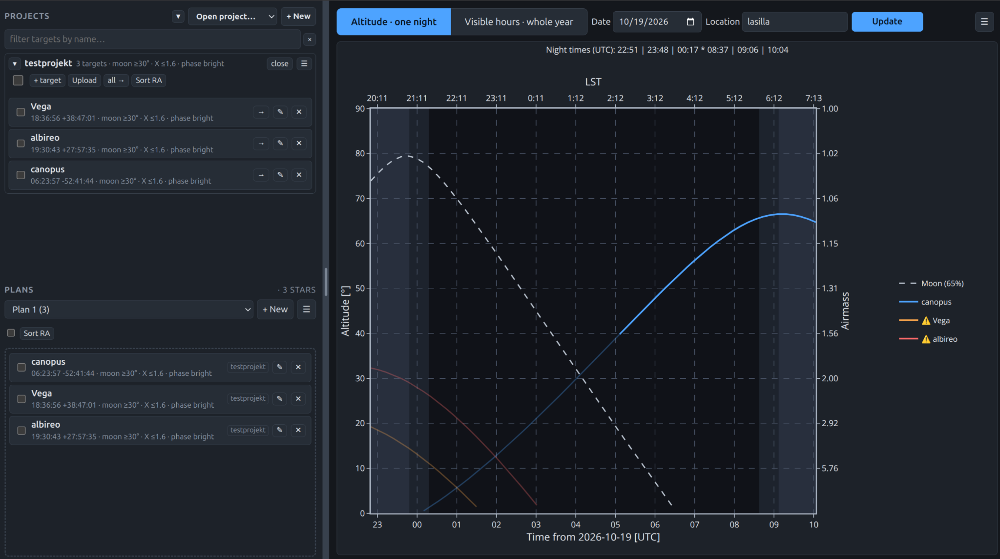
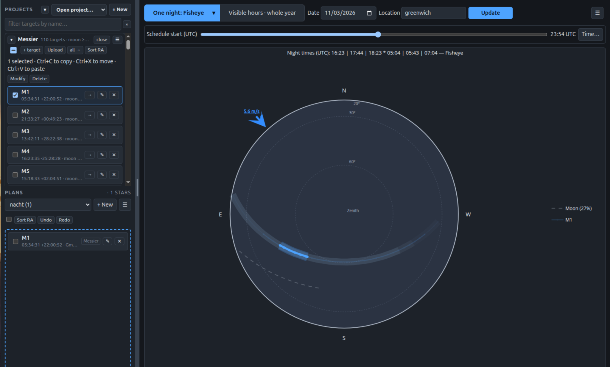
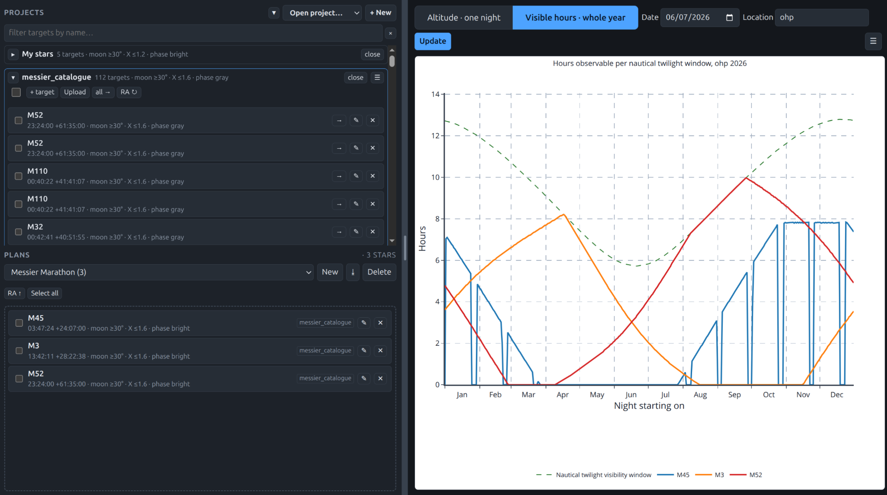
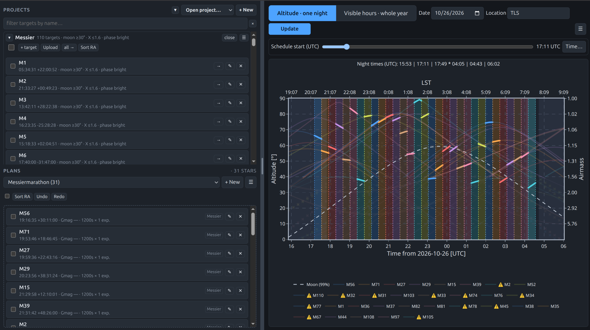

# Sky Observation Planner

**Version 0.7 — 3 November 2026.**

*Maintenance corrections: 4 November 2026 (translations, plotting layout, launcher-session reliability).*

**Plan your observing night, explore target visibility, and turn a list of astronomical objects into a practical observing schedule.**

Sky Observation Planner is designed to make astronomical observation planning quick and intuitive. Explore when your targets are visible from your preferred observatory with an interactive **nightly altitude or All-Sky/Fisheye plot**, or look ahead through the seasons with an **annual visibility plot**. Set your observing limits, compare the Moon's position and other observing conditions, and find suitable windows for your targets before heading to the telescope.

Start with your own CSV target catalogue, use the included Messier catalogue as an example, or look up objects directly in **SIMBAD** to build a personal target list. You can then select targets, arrange them into an observing plan, and create a timed schedule for the night. The application runs locally on your computer and opens in your web browser; its interactive plots support zooming, hovering and exporting images.



*Example of the nightly altitude plot, showing target visibility, the Moon and twilight intervals.*

## Getting started

Sky Planner uses Python, Flask and Astropy. A Conda environment is convenient, but not mandatory. Commands below should be run from the directory containing `app.py` and `requirements.txt`.

### Install the Python dependencies

If you use Conda, activate the environment where you want Sky Planner installed (the supplied GNOME launcher uses `base` by default):

```bash
conda activate base
pip install -r requirements.txt
```

### Start Sky Planner manually

```bash
python app.py
```

Open **http://127.0.0.1:5511** in your browser. The default port is `5511`; to choose another one, set `SKY_PLANNER_PORT` before starting the program.

### Install the GNOME desktop launcher (Ubuntu 24.04 and similar Linux systems)

First, extract the ZIP archive into the folder where you want to keep the application. Open a terminal **in that folder**, then run:

```bash
chmod +x launch_sky_planner.sh install_desktop_launcher.sh
./install_desktop_launcher.sh
```

Find **Sky Observation Planner** in the GNOME application menu or on the desktop (if desktop icons are enabled). The launcher first activates Conda `base` if installed; otherwise it tries a project `.venv`/`venv` and then a Python 3.10+ installation with all dependencies. It starts the local web server and opens your system's default browser. GNOME may ask you to select **Allow Launching** for the desktop icon. If you move the application folder later, run the installer again so its paths are updated.

A browser refresh preserves the server session; closing the tracked tab/window normally stops the server after a **12-second reconnection grace period**. **Missed heartbeats alone no longer stop the server**: inactive browser tabs and suspended laptops may pause heartbeats without closing the application. If the browser crashes or fails to send its close notification, the server may remain running until manually stopped. Quickly reopening the launcher reconnects the existing tracked session and cancels a pending close. Shutdown detection is best effort. No separate Stop shortcut is installed.

**Without Conda (Linux or macOS):** From the extracted project directory, run:

```bash
python3 -m venv .venv
.venv/bin/python -m pip install -r requirements.txt
```

The launcher installation commands are unchanged from v0.61. **Keep `desktop_session.py` in the same folder as `app.py` and both `launch_sky_planner*.sh` scripts**: both launchers now call that shared helper to decide when their server session should close. If updating only selected files from a previous installation, include this new helper. No reinstall is required when replacing the application files in their original folder.

The desktop launchers use the existing Conda activation method if Conda is available. Only if Conda is **not found** do they check `.venv`, `venv`, and then `python3`/`python` for Python 3.10+ and all required packages. If Conda is found but its `base` activation fails, the launcher reports that error rather than silently using a different interpreter. The launchers do not install dependencies automatically.

### Install the macOS Finder launcher (Apple Silicon or Intel Mac)

Install the dependencies either in Conda `base` (for example with [Miniforge](https://github.com/conda-forge/miniforge)) or in a project virtual environment with `python3 -m venv .venv` followed by `.venv/bin/python -m pip install -r requirements.txt`. Conda is **not required**. Keep the extracted Sky Planner folder in a permanent location. From Terminal, **inside the Sky Planner folder**, run:

```bash
chmod +x launch_sky_planner_mac.sh install_mac_launcher.sh
./install_mac_launcher.sh
```

This creates **~/Applications/Sky Observation Planner.app**. Open it from Finder (or macOS app search when indexed); it prefers Conda `base` when available, otherwise uses a project `.venv`/`venv` or suitable system Python; it starts Waitress and opens your **default browser**. No PyInstaller compilation or administrator privileges are required. The `.app` is a small launcher referencing the extracted project folder; rerun the installer after moving that folder. If macOS blocks a downloaded app, use Finder's **Open** context menu or review **System Settings → Privacy & Security**; run only code you trust.

The macOS server log is **~/Library/Logs/SkyPlanner/server.log**. The launcher supports `SKY_PLANNER_HOST` (default `127.0.0.1`) and `SKY_PLANNER_PORT` (default `5511`) when invoked from Terminal. For a browser reload, the server remains alive and accepts a reconnect; closing the session tab or browser window sends a close signal, and the server normally exits after a **12-second** reconnection grace period. Missing heartbeats never shut down the server on their own: this prevents spurious shutdown while the browser is backgrounded or the computer is sleeping. If a close beacon is lost (for example, after a browser crash), manually stop the launcher-owned server if necessary. Quickly reopening the launcher reconnects the existing tracked session and cancels a pending close. Browser shutdown detection is best effort; a second browser tab that does not carry the session token does not keep the owned server alive.

## Author and licence

**Author:** D. Sebastian  
**Licence:** MIT License — Copyright © 2026 D. Sebastian. See [LICENSE](LICENSE) for the full terms.

## 2. Basic usage: projects and plans

### Projects: reusable target catalogues

A **project** is a collection of astronomical targets with default observing constraints. Select an existing project or use **+ New** to create one. Several projects can be open simultaneously. Add targets by hand (**+ target**) or use **Upload** to import a CSV catalogue. A SIMBAD search can fill coordinates from a target name when internet access is available. SIMBAD identifier resolution is independent of optional Gaia G photometry and radial velocity: missing values do not prevent successful coordinate lookup, and available radial velocity is filled silently.

Each target has a name, right ascension (RA) and declination (Dec). RA is expressed in hours and Dec in degrees; sexagesimal entries such as `12:30:00` and `+15:20:00` are accepted. The original coordinates are retained even when their display is reformatted.

Use the project **☰** menu for defaults, CSV export and deletion. You can reorder targets by dragging, or sort numerically by RA. Each project's RA sorting is separate from the plan's sorting. Search/filter the catalogue and use selection checkboxes or multiselection to work with several targets.

### Plans: select what to observe

A **plan** contains independent copies of project targets. Copy targets into a plan with the arrow control, multiselection or drag and drop. A target can appear more than once. Editing or removing a plan copy does **not** change the original project target.

Use **+ New** for a new plan, and the plan **☰** menu to change settings, copy the plan to a new name, export its CSV, or delete it. Targets can be reordered by dragging; their order matters in **Schedule** mode. **Sort RA** sorts all plan targets by right ascension, or only selected targets if any are selected; unselected targets keep their positions. The sorted order is saved and can be freely rearranged by dragging. **Undo** restores up to 30 previous target-list changes within the current server session (including sorting, reordering, additions and deletions). Project sorting is independent and unchanged.

### Target fields and observing limits

The target editor includes maximum **airmass**, maximum **Moon illumination** (`bright` ≤100%, `gray` ≤70%, `dark` ≤40%), minimum **Moon distance** in degrees, optional **Moon velocity separation limit** and **telluric velocity separation limit** in km/s, and optional target **radial velocity** in km/s. Velocity limits are only enforced when target RV is supplied. Leaving a velocity limit empty disables it.

The editor also stores **exposure time** (seconds), **number of exposures** (a positive integer), **delay** (minutes in the interface; seconds in stored data), and **comments** (up to 1,000 words). Exposure time and delay accept decimal numbers, including `2700.0`; number of exposures must represent a whole number.

Project defaults include airmass, Moon phase, Moon distance and optional Moon/telluric velocity limits. These are used for new project targets and can be applied to existing project targets when requested. The Moon velocity limit is only applied, if the Moon is above the horizon. This is set by the project default **Moon velocity altitude [deg]** (default is 3°).

## 3. Sites

Sites, alraedy loaded in astropy can be selscted. See list of sites here: https://docs.astropy.org/en/stable/api/astropy.coordinates.EarthLocation.html#astropy.coordinates.EarthLocation.get_site_names

Simply start typing your preferred site and use the autofill to complete them. Sites can be added manually by adding them in the list, loaded in sites.py

## 4. Plotting

Choose the date and observing **Location**. Click the main **One night: Altitude/Fisheye** button to immediately compute that night view, even after using the yearly plot. Use the **separate ▾ arrow** to choose **Altitude** (time/altitude chart) or **Fisheye** (zenithal All-Sky chart) at any time. Click **Visible hours · whole year** for the yearly view. The night projection choice is remembered in this browser. Click **Update** to recompute with current values; the button displays an animated **Calculating** state while processing. Plotly allows zooming, panning, legend interaction and image export. The plot color theme is independent of the surrounding website, which follows the operating system's light/dark appearance. Drag the divider to resize the catalogues and plot.

### One night → Altitude

This plot shows each target's altitude throughout the night, the Moon's altitude, twilight shading, UTC time, local sidereal time and an airmass axis. The title lists the calculated solar events; hover over it for explanations. Target hover information reports altitude, airmass, Moon separation and relevant velocity values. Low-visibility intervals are subdued or crossed; warning symbols mark targets/blocks that fail constraints. A target that stays below the horizon is **not** observable.

### One night → Fisheye (All-Sky)



The Fisheye view uses a **zenithal equidistant projection** of the same night: the default outer circle is **altitude 20°**, the zenith is at the center (**90°**), and the inner rings mark 30° and 60° (when above the selected limit). Faint dotted **north–south (meridian)** and **east–west** guide lines cross at the zenith, matching the altitude-ring style. **North** is up, **East** is left, South down and West right. Each target and the Moon trace their positions across the selected night; positions below the configured minimum altitude are not drawn. This minimum is a **display filter only**: it does not change astronomy calculations or scheduled-block validity. The projected tracks use the same colours, warnings, faded airmass-limit segments and Moon/phase/velocity checks as the altitude plot.

In **☰ Settings**, **Fisheye plot - horizon limit [°]** accepts decimal values from 0 to below 90° (default 20°). The view scales the chosen altitude to its outer ring, hiding lower-altitude tracks and ribbons. The circle uses the available plot area and is reduced only when the arrow or wind speed label would otherwise extend beyond the normal plot boundaries. **Fisheye plot - toggle Wind info** (off by default) adds a broad blue arrow just outside the circle at the *FROM* azimuth of the current 10-metre wind at the selected observatory, pointing inward in the direction the air travels. The speed in m/s is a clickable link to [Open-Meteo](https://open-meteo.com/en/docs); attribution is shown right beside the data. Wind data are current weather-model conditions, **not** predictions for the date selected in the planner, and may differ from measurements at the telescope. Wind requests need internet access; they are cached for 10 minutes and failures leave plotting unaffected. Open-Meteo data are licensed under [CC BY 4.0](https://creativecommons.org/licenses/by/4.0/); the public service is intended for non-commercial use. Both preferences are remembered in the browser.

Hover over a track or marker to see the corresponding **UTC time, altitude, azimuth, airmass, Moon separation and velocity/limit information**; click a target track to highlight and scroll to that target in the plan. Legend interactions, zooming, panning, automatic view reset, screenshot export, theme selection and the title's twilight-event tooltip are retained. Changing the plan or observing site/date updates either night projection.

The translucent **twilight regions are projected along each target's trajectory**, rather than drawn as time-wide vertical rectangles. In **Schedule** mode the same block calculations and UTC start-time slider apply. A coloured ribbon marks the portion of each target's sky path occupied by its scheduled block; its bright centre line shows observing details and whole-block validity on hover, with a readable separator between current values and schedule information. Since azimuth and altitude do not uniquely encode time, an All-Sky view cannot show a full-width time band or provide the altitude plot's “hover anywhere in the time band” interaction. Instead, hover directly over a scheduled trajectory; for full-width time-band hover use the Altitude view.

### Visible hours · whole year



For every night in the selected year, this plot estimates how many hours each target meets the configured observing limits. The x-axis is labelled **Month**; all four plot sides carry axis borders/ticks. Plot titles, month abbreviations and hover text follow the selected GUI language. Use **☰ Settings** to select the Sun-altitude boundary for the yearly observing window: **sunset (0°)**, **civil twilight (−6°)**, **nautical twilight (−12°, default)** or **astronomical twilight (−18°)**. The same limits (airmass, Moon phase/distance and configured velocity constraints) contribute to the visibility calculation. Violations are indicated on the yearly curves. Identical targets with matching coordinates and constraints are evaluated once and identified by a count.

The visibility calculation uses time sampling (approximately two minutes); velocity ephemerides are cached/interpolated to make repeated yearly plots faster. Treat the result as an observing-planning estimate, especially close to a limit threshold.

## 5. Scheduling observations



Open the plan **☰** menu and change its **Mode** from **Plan** to **Schedule**. Schedule-only defaults then become visible:

- **Default exposure time**, with an option to apply it to every existing target in that plan.
- **Default delay between exposures**, with an option to apply the delay to every existing target in that plan.
- **Start of observation**: **sunset**, **civil**, **nautical** (default) or **astronomical twilight**.
- 
The schedule uses the plan's **target order**. Each target is an observing block with duration

`(exposure time + delay) × number of exposures`.

The first block normally starts at the selected twilight event, based on the chosen date and observatory. Subsequent blocks follow in order. Move the time slider to shift the start. With the slider focused, press **Space**, or select **Time…**, to choose the current time (UTC), enter a UTC time or reset to the configured twilight. Current time uses the UTC clock time regardless of the computer’s time zone, on the selected observing night (including after midnight). If that UTC time is outside the plotted night, a message is shown and the schedule is not changed.

In the **Altitude** projection, a translucent time band identifies each scheduled block; target altitude curves are drawn above the bands. Scheduled segments stand out and the remaining portions are faded. Vertical lines mark block start/end. Hover **anywhere inside a block** to see that block's target data at the mouse's UTC time (including altitude, airmass, Moon distance and applicable velocities), exposure settings and overall block validity. Other targets' curves do not take over the schedule tooltip.

A block is evaluated over its complete duration: a limit violated within the block marks it with a warning symbol (including in the legend). Changing the target order, adding targets or moving the start time causes the schedule to be evaluated again. The **Fisheye** projection shows the same blocks on the sky as coloured trajectory ribbons, and the **yearly** plot continues to show unscheduled observable hours.

## CSV catalogue import reference

**Required header fields:** `name,ra,dec`. The following are all supported canonical fields. Header aliases shown in the third column are accepted case-insensitively. Unspecified optional observing settings use the applicable project defaults.

| CSV field | Description | Accepted aliases |
|---|---|---|
| `name` | Target identifier, required | `object`, `star`, `target`, `targets` |
| `ra` | Right ascension, hours (sexagesimal or decimal), required | `alpha`, `right_ascension`, `rightascension` |
| `dec` | Declination, degrees, required | `declination`, `delta` |
| `gmag` | Gaia G magnitude (optional) | `gaia_g`, `gaia_g_magnitude`, `gaia_gmag` |
| `moon` | Minimum Moon separation, degrees | `moon_limit`, `moonlim` |
| `airmass` | Maximum airmass | `airlim`, `airmass_limit` |
| `phase` | Moon illumination category: dark / gray / bright | `moon_phase`, `moonphase` |
| `radial_velocity` | Target systemic radial velocity, km/s | `rv` |
| `moon_velocity_limit` | Minimum target–moonlight velocity separation, km/s | `moon_rv_limit` |
| `telluric_velocity_limit` | Minimum target–telluric velocity separation, km/s | `telluric_rv_limit` |
| `exposure_time` | Single-exposure duration, seconds | `exptime` |
| `exposures` | Number of exposures, positive integer | `nexp`, `number_of_exposures` |
| `delay` | Delay per exposure, seconds | `delay_seconds` |
| `comments` | Free-text notes | `comment`, `notes` |
| `add` | Legacy selected flag; ignored for project imports | `plot`, `select`, `selected` |

An uploaded CSV may also use a headerless three-column `name,ra,dec` format or the legacy six-/seven-column layout described in the web guide. The bundled `tab_test.csv` is a deliberately untidy real-world example using mixed sexagesimal coordinates and a headerless layout.

## Schedule CSV export

In Schedule mode, **Download** exports one row per observing block, in plan order. The initial columns contain identity and **computed/scheduled** UTC start/mid/end times; altitude, airmass and Moon angular separation are evaluated at all three times; start/mid/end barycentric, moonlight and relative velocities are calculated as well. Exposure time, exposure count and delay follow. Only **after these** come fields named `default_*`: target observing limits and radial velocity. Thus scheduled measurements are explicitly distinguishable from configured constraints. Missing stellar radial velocity produces empty relative-velocity fields. The export reflects the chosen observatory/date and the slider-selected UTC start time, when applicable. Values are instantaneous samples, not full-block maxima/minima.

## Python API (NumPy arrays)

```python
import obs
targets = obs.read_targets('tab_test.csv')
night = obs.staralt(targets, location='paranal', date='2027-12-31')
twilight = obs.twilights(location='paranal', date='2027-12-31')
year = obs.annual(targets, location='paranal', year=2027)
```

`staralt()` accepts CSV paths, pandas DataFrames and scalar/vector Astropy `SkyCoord` values. Its result has two keys:

- `time`: NumPy `datetime64[ns]` array of UTC instants for the observing night.
- `targets`: dictionary indexed by target name; each target has NumPy `float` arrays `altitude` (deg), `airmass`, `moon_distance` (deg), `barycentric_velocity` (km/s), `moon_velocity` (km/s), `moon_velocity_difference` (km/s) and `telluric_velocity_difference` (km/s). All arrays align with `time`. Duplicate names receive suffixes `#2`, `#3`, etc. Missing target RV means `NaN` in the two relative-velocity arrays. Below-horizon airmass is `NaN`. No twilight fields or plot metadata are returned.

`twilights()` returns **only** the event dictionary with keys `sunset`, `nautical_dusk`, `astronomical_dusk`, `astronomical_dawn`, `nautical_dawn` and `sunrise`; values are UTC Python `datetime` objects, or `None` if the event does not occur.

`annual()` returns `dates` (NumPy `datetime64[D]`, site-local *calendar dates*), `time_utc` (NumPy `datetime64[ns]` for the sampled **local mean solar midnight** at the site's longitude) and `targets` (name → metric arrays). Metrics are `observable_hours` (whole-night integral), `moon_distance`, `barycentric_velocity`, `moon_velocity`, `moon_velocity_difference` and `telluric_velocity_difference`. Angular distances are degrees; velocities km/s. Local mean midnight uses longitude, not the civil time zone. The annual visibility hours belong to the night associated with that calendar date and are not an instantaneous measurement.

All API outputs are intended for NumPy analysis, not directly JSON-serializable. The web application continues to use its existing independent JSON plotting interfaces.
